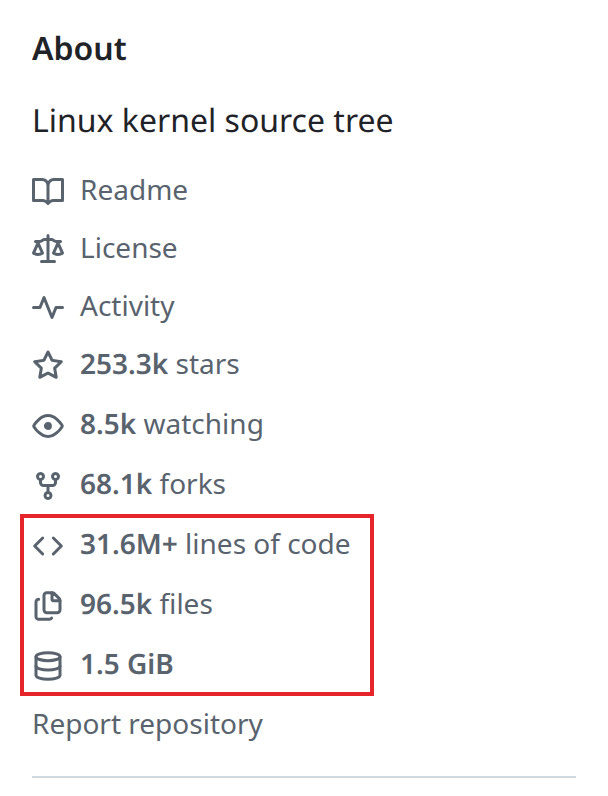
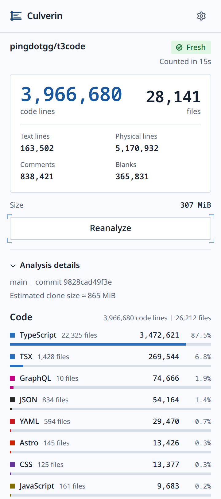
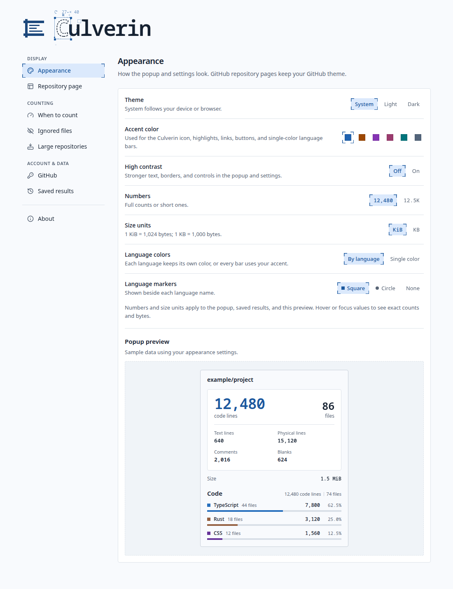

<picture>
  <source media="(prefers-color-scheme: dark)" srcset="assets/culverin-icon-dark.svg">
  
</picture>

# Culverin

Code stats for GitHub repositories, computed locally in your browser with Rust and WebAssembly.

[Install](#install) · [Features](#features) · [Privacy](#privacy) · [Documentation](#documentation)

  <picture>
    <source media="(prefers-color-scheme: dark)" srcset="assets/screenshots/torvalds-linux/about-marked-dark.png">
    
  </picture>

## Features

- **Stats in the About sidebar.** Lines of code, file count, and size appear next to stars and forks on the repository page.
- **A full breakdown in the toolbar popup.** Code lines per language, text lines for Markdown and other prose, comments, blanks, files Culverin does not recognize, and an estimated clone size.
- **Counted on your machine.** The source archive goes straight from GitHub to your browser and is counted in memory by [Tokei](https://github.com/XAMPPRocky/tokei) compiled to WebAssembly. There is no Culverin server.
- **Private repositories.** Connect the Culverin GitHub App or paste a read-only personal access token. Public repositories need no account.
- **Any branch, tag, or commit.** Culverin counts whatever the page shows, not only the default branch.
- **Ignore rules.** Leave out dependencies, build output, lockfiles, and minified files, or add your own rules for folders, file endings, names, and paths.
- **Large repositories.** Choose a download limit from 256 MiB to 4 GiB.
- **Saved results.** Results are kept locally and shown again while the repository stays at the same commit.

  <picture>
    <source media="(prefers-color-scheme: dark)" srcset="assets/screenshots/pingdotgg-t3code/popup-dark.png">
    
  </picture>

## Install

Culverin needs Chrome 127 or later.

**Chrome Web Store:** coming soon.

**From a release:**

1. Download the latest `culverin-<version>.zip` from [Releases](https://github.com/0xKa/culverin/releases/latest) and unzip it.
2. Open `chrome://extensions` and turn on **Developer mode**.
3. Choose **Load unpacked** and select the unzipped folder.

Each release lists the SHA-256 checksum of its ZIP.

## Usage

1. Open any repository on GitHub.
2. Click **Analyze with Culverin** in the About sidebar, or open the Culverin popup from the toolbar and choose **Analyze repository**.
3. The totals appear in the sidebar. Click them to open the full breakdown.

Culverin downloads source only when you ask it to. To count every repository you open, turn on counting on page open in Settings → When to count.

<strong>Settings</strong>

 

<picture>
  <source media="(prefers-color-scheme: dark)" srcset="assets/screenshots/settings-appearance-dark.png">
  
</picture>

- **Appearance:** system, light, or dark theme, high contrast, accent color, full or short numbers, binary or decimal size units, and language colors.
- **Repository page:** which rows the About sidebar shows and in what order, and whether to hide them on private repositories or everywhere.
- **When to count:** only when you click, which is the default, or as soon as a repository page opens.
- **Ignored files:** built-in exclusion groups and your own rules. Settings sync through Chrome sync when it is on.
- **Large repositories:** the maximum download for counts you start.
- **GitHub:** connect an account for private repositories and see how many API requests you have left.
- **Saved results:** view, delete, or clear saved public and private results.

<strong>What gets counted</strong>

 

Culverin downloads the source archive of the exact commit the page shows and counts it with Tokei 15. Results are Tokei results, so they can differ from `cloc` or GitHub's language bar.

- **Code** is every file in a language Tokei recognizes, split into code, comments, and blanks.
- **Text** is prose in Markdown, MDX, Djot, and plain text files, including README, LICENSE, and CHANGELOG files without an extension. It is not added to code lines.
- **Other files** are files Culverin does not recognize as a language, grouped by extension. They are not added to code or text lines.
- **Files** and **Size** cover every file at the commit, including ignored and binary files. Size excludes Git history.

A source file over 8 MiB is skipped. The result is then marked partial: the sidebar total ends with `+`, and the popup lists the skipped files with links to them.

[Result semantics](docs/result-semantics.md) describes the counting rules in full.

<strong>Limits</strong>

 

Every count runs inside your browser, so each one is bounded. When a limit is reached, the count stops and no total is shown.

| Limit            | Value                                                                                    |
| ---------------- | ---------------------------------------------------------------------------------------- |
| Download         | 512 MiB by default, from 256 MiB to 4 GiB in Settings                                    |
| Unpacked archive | 8 × the download limit                                                                   |
| Archive entries  | 2,000,000                                                                                |
| Files            | 1,000,000                                                                                |
| One source file  | 8 MiB; larger files are skipped and the result is marked partial                         |
| Automatic counts | 256 MiB downloaded, whatever the download limit says                                     |
| Time             | Stops after 30 seconds without data, 60 seconds without progress, or 60 minutes in total |

One count runs at a time, and others wait in a queue. [Limits](docs/limits.md) lists every limit and how real repositories compare with them.

<strong>Private repositories</strong>

 

Connect GitHub in Settings → GitHub in one of two ways:

- **Connect with GitHub** uses the Culverin GitHub App. You enter a short code on GitHub, approve the app, and choose which repositories it may read. The app can only read repository contents and metadata, and its token expires after 8 hours.
- **Personal access token:** a fine-grained token with read-only access to repository contents is enough.

Tokens are sent only to GitHub. They never reach the script that runs on GitHub pages, the popup, or the analysis worker. Private results are stored apart from public ones and can be cleared separately.

## Privacy

Culverin has no backend, no account of its own, no telemetry, and no analytics. Requests go directly from your browser to GitHub, without your GitHub cookies. Source code is counted in memory and discarded. Only the totals are saved, in the extension's local storage.

<strong>Permissions</strong>

 

| Permission                      | Why                                                     |
| ------------------------------- | ------------------------------------------------------- |
| `storage`                       | Keeps settings and saved results.                       |
| `offscreen`                     | Runs the archive worker that unpacks and counts source. |
| `https://github.com/*`          | Adds the rows to the About sidebar on repository pages. |
| `https://api.github.com/*`      | Reads repository metadata and the commit to count.      |
| `https://codeload.github.com/*` | Downloads the source archive when you choose to count.  |

The extension runs only packaged code, under a content security policy that allows no remote scripts.

The [privacy policy](docs/privacy.md) lists every request and everything that is stored.

## Documentation

- [Architecture](docs/architecture.md)
- [Result semantics](docs/result-semantics.md)
- [Limits](docs/limits.md)
- [Privacy](docs/privacy.md)
- [Changelog](CHANGELOG.md)
- [Contributing](CONTRIBUTING.md), including how to build from source
- [Security policy](SECURITY.md)

<strong>Origins</strong>

 

Culverin began as a server-based project: a Go backend that fetched GitHub repository archives, counted lines with a pinned `cloc` release, and served results over an HTTP API to a companion browser extension and web interface. That design required repository source code to pass through server infrastructure, along with the operational burden of hosting, credentials, and abuse control.

This repository is a clean rewrite with a different architecture: everything now runs locally in your browser using Rust and WebAssembly, repository contents travel only from GitHub to you, and no Culverin server exists at all. The earlier implementation was retired as a learning vehicle; none of its code or history is carried over.

## License

[Apache License 2.0](LICENSE)
